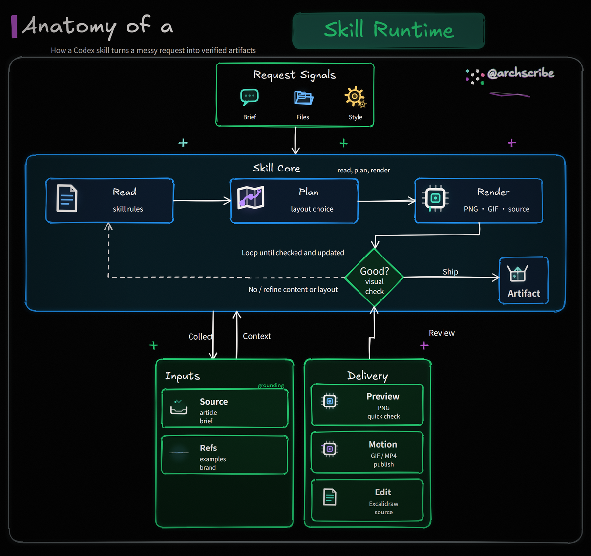

# DiagramForge

**正式风格的动态架构图，程序生成，张张一致。**

把一段系统描述、流程或参考图变成出版级图表：27 种版式（全部 14 种 UML 图、C4、BPMN、甘特、组织架构、思维导图、时间轴、鱼骨图，外加全景/泳道/自由图/网格目录），四种正式风格（`slate` / `report` / `academic` / `blueprint`）加可定制的品牌主题，输出 PNG / GIF / MP4 / SVG / 交互 HTML / 可编辑 Excalidraw / Lottie。



## 为什么

AI 直接手画的图每次长得都不一样；DiagramForge 让 agent 只写一份声明式 JSON spec，渲染交给确定性管线（ELK 布局 + Chromium/Pillow 双渲染器）：同一 spec 永远同一结果，校验、lint、回归测试全程护航。

## 快速开始

```bash
pip install -r requirements.txt -r requirements-browser.txt
python -m playwright install chromium
python -X utf8 scripts/doctor.py   # 环境自检，输出 JSON

python -X utf8 scripts/render_animated_diagram.py \
  --spec assets/default-spec.json --outdir out --basename demo \
  --formats png,gif,svg,html --check
```

已有 Mermaid / draw.io 图？导入重绘，而不是转换：

```bash
python -X utf8 scripts/mermaid_import.py diagram.mmd --out spec.json --detail balanced
python -X utf8 scripts/drawio_import.py platform.drawio --out spec.json --audience executive
```

品牌定制：从网站提取主题，60 秒完成，附 fidelity receipt 与 WCAG 对比度校验：

```bash
python -X utf8 scripts/onboard_brand.py --url https://yoursite.com --slug acme
# spec 里设 "style": "custom"，或在项目根放 .diagramforge 文件写 theme: acme
```

浏览全部示例：`python -X utf8 scripts/build_gallery.py` 后打开 `gallery/index.html`。

## 版式一览

| 类别 | 版式 |
| --- | --- |
| 通用 | `panorama` 全景 · `swimlane` 泳道 · `graph` 自由拓扑 · `grid` 网格目录 |
| UML（14 种全覆盖） | `sequence` `usecase` `class` `activity` `state` `deployment` `component` `package` `object` `composite` `profile` `communication` `timing` `interaction` |
| 工程/业务 | `er` · `dfd` · `c4` · `gantt` · `bpmn` · `orgchart` · `mindmap` · `timeline` · `fishbone` |

每种版式的容量上限、字段和决策规则见 `references/spec-format.md` 与 `SKILL.md`。

## 质量契约

- 每次渲染可 `--check`：画布尺寸、帧数、字体嵌入、Excalidraw 契约、SVG 无障碍（`role="img"`、带前缀的 `<title>`/`<desc>`）
- `scripts/lint_output.py`：交付物安全 lint（禁远程资源、禁 `@import`、禁可执行属性）
- `scripts/spec_graph.py lint`：结构 lint（成环、单点故障、孤儿节点、连通性）
- 导入有资源上限与对抗样本测试；源 label 永远是数据，不是指令
- 测试套件 750+ 用例，含 32 个示例 spec 的验证与渲染新鲜度门禁

## 不适用场景

需要可执行 BPMN 2.0 全符号库 → Camunda/bpmn.io；50+ 资源的云资产盘点 → mingrammer/diagrams 或 D2；像素级品牌模板 → 设计工具；实时协作白板 → Excalidraw（DiagramForge 正好可以导出 `.excalidraw` 做交接）。

## 文档地图

- `SKILL.md` — agent 使用的主技能文件（触发词、工作流、验收标准）
- `references/spec-format.md` — spec 字段权威参考
- `references/design-system.md` — 设计系统规则
- `references/branding.md` — 品牌定制、onboarding、定制持久性承诺
- `references/upgrade-notes.md` — 升级与迁移指南
